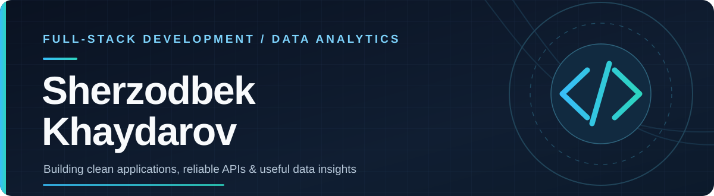

 

  

---

## About

I’m a full-stack developer who enjoys turning real workflow needs into clear, dependable software: thoughtful interfaces, reliable APIs, and useful data insights.

## What I Work On

<table width="100%">
<tr>
<td width="33%" valign="top">

### Product Engineering

Responsive web interfaces and practical end-to-end product features.

</td>
<td width="34%" valign="top">

### Backend & APIs

Structured REST APIs, authentication, and maintainable server-side systems.

</td>
<td width="33%" valign="top">

### Data & Analytics

SQL and Python workflows, reporting, and dashboards that make data easier to use.

</td>
</tr>
</table>

## Technology

<table width="100%">
<tr>
<td width="33%" align="center" valign="top">

### Frontend

React · Next.js · TypeScript · Tailwind CSS

</td>
<td width="34%" align="center" valign="top">

### Backend

Node.js · NestJS · Express · PostgreSQL

</td>
<td width="33%" align="center" valign="top">

### Data

SQL · Python · Power BI · Excel

</td>
</tr>
</table>

## GitHub Activity

